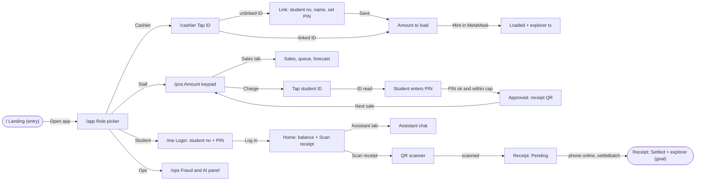
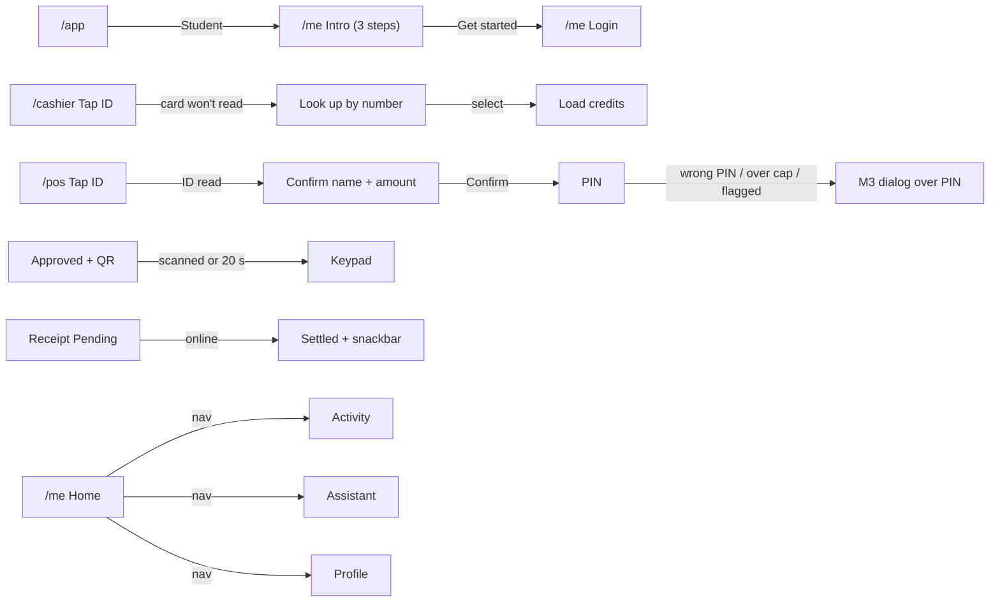

# HeronPay: First Look (Design Spec)

Source: `UMak-Pay-Hackathon-PRD.md` (Nov 13, 2026). References and launch checklist are in `references.md`.

## Grilling decisions (2026-11-13)

| # | Decision |
| --- | --- |
| 1 | `/cashier` runs on an **Android phone**: Chrome reads the ID over Web NFC, and the MetaMask mobile app signs `mint()` (wagmi MetaMask connector) |
| 2 | **The cashier links IDs** at first top-up: an unlinked ID opens a link step (student number, name, the student sets a PIN) → `POST /link` |
| 3 | Extra screens: **role picker**, **fraud and AI panel** (`/ops`), **pitch landing page**, **merchant sales and forecast** tab on `/pos` |
| 4 | Tone: **dark ops with UMak flavor** |
| 5 | POS sale entry: **peso keypad plus quick-item chips** |
| 6 | Design **every error and empty state** listed below |
| 7 | Branding: **our own "HeronPay" wordmark plus UMak school colors** as accents; no official seal. School color hex values are placeholders until the team confirms them |
| 8 | Copy: **English and Filipino**, with an EN/FIL toggle |
| 9 | `/me` login: **student number plus PIN**, checked online once, then remembered on the phone |
| 10 | Routes: **landing at `/`**, role picker at `/app`, AI panel at `/ops` |
| 11 | `/me` home: **balance (pending subtracted) and a large Scan receipt button**, then recent receipts; the assistant is a tab |

Platform: the app routes are **phone-first, 390 px, Android Chrome**. On wider screens they render as a centered 440 px column. `/` and `/ops` are **desktop-first** (laptop and projector) and must also work on a phone.

## Screens

| Route | Screen | One job |
| --- | --- | --- |
| `/` | Landing | Pitch HeronPay to judges and open the app |
| `/app` | Role picker | Send each demo phone to the right screen in one tap |
| `/cashier` | Cashier top-up | Tap an ID, link it if new, mint credits in MetaMask, show the tx |
| `/pos` | Stall POS | Charge a sale offline: amount, ID tap, PIN, receipt QR |
| `/pos` › Sales | Sales and forecast | Today's sales, the settlement queue, busy hours |
| `/me` | Student wallet | See the balance, scan receipts, watch them settle |
| `/me` › Assistant | Spending assistant | Answer questions about the student's own receipts |
| `/ops` | Fraud and AI panel | Show live receipts, clone flags and offline caps on the projector |

## App flow



### States to design

| Screen | State | What the user sees |
| --- | --- | --- |
| Any NFC screen | NFC off or unsupported | "Turn on NFC and use Chrome on Android" with a retry |
| `/cashier`, `/pos` | Waiting for tap | Pulsing tap target (static under reduced motion) |
| `/pos` | POS cache not synced | Banner "Student list not synced. Connect once to sync." Charge is disabled |
| `/pos` | Unlinked ID | "This ID isn't linked yet. Send the student to the cashier." |
| `/pos` | Wrong PIN | "Wrong PIN, 2 tries left"; after 3 tries the ID is locked on this POS for 5 minutes (placeholder rule, team to confirm) |
| `/pos` | Over the offline cap | "Offline limit for this student is ₱X. Charge less or go online." |
| `/pos` | Not enough balance | "Balance after pending payments: ₱X" |
| `/pos` | Flagged ID (cap 0) | "Offline payments paused for this ID. Pay online or at the cashier." |
| `/pos` Sales | Queue empty / pending N | "All settled" or "N receipts waiting for signal" |
| `/me` | No receipts yet | "No payments yet. After you pay, scan the receipt QR." |
| `/me` | Pending, offline | Tag "Pending, waiting for signal" |
| `/me` | Failed at settlement | Tag "Failed: not enough balance at settlement", with an explanation |
| `/me` Assistant | Offline | "The assistant needs signal. Your receipts are saved." |
| `/ops` | No flags | "No flags. Caps are up to date." |

## Wireframes

App routes are drawn at phone width (40 columns). At desktop width they are the same column centered on a dark field, so only `/`, `/ops` and the POS-on-tablet view get 100-column drawings.

### `/` Landing, desktop

```
+--------------------------------------------------------------------------------------------------+
| [HeronPay]                     How it works   Proof   AI safety   Roadmap     [EN|FIL] [Open app]|
+--------------------------------------------------------------------------------------------------+
|                                                                                                  |
|  TESTNET DEMO                                              +--------------+                      |
|  Tap your ID.                                              |  phone mock: |                      |
|  Pay with no signal.                                       |  /pos receipt|                      |
|  Settle on-chain later.                                    |  QR approved |                      |
|                                                            +--------------+                      |
|  [Open app]   [See it on the explorer ->]                                                        |
+--------------------------------------------------------------------------------------------------+
|  1 LOAD                      2 PAY OFFLINE                 3 SETTLE                              |
|  Cashier taps ID, mints      Stall: tap ID + PIN,          First phone online submits;           |
|  credits in MetaMask         receipt QR to student         contract skips duplicates             |
+--------------------------------------------------------------------------------------------------+
|  LIVE PROOF  (from the contract)                                                                 |
|  [ settled payments: n ]  [ total ₱ settled ]  [ last tx 0x..ab ->explorer ]  [ contract addr ]  |
+--------------------------------------------------------------------------------------------------+
|  AI KEEPS OFFLINE SAFE                         |  KNOWN LIMITS (said up front)                   |
|  Personal offline caps, clone detection        |  UIDs can be cloned -> PIN + caps + flags ...   |
+--------------------------------------------------------------------------------------------------+
|  ROADMAP: BLE mesh relay | anti-clone IDs (NTAG 424 DNA) | UMak pilot                            |
+--------------------------------------------------------------------------------------------------+
| HeronPay  Product: Open app, How it works   Team: About, Contact   Legal: Privacy, Terms, Data   |
| Testnet only, no real money. Not affiliated with UMak.                    (c) 2026 HeronPay team |
+--------------------------------------------------------------------------------------------------+
```
Components: top nav with language toggle, hero + phone mock, 3-step strip, proof stat band (each stat links to the explorer), AI and limits split, roadmap row, full footer with legal links.

### `/` Landing, phone

```
+--------------------------------------+
| [HeronPay]            [EN|FIL] [=]   |
| TESTNET DEMO                         |
| Tap your ID.                         |
| Pay with no signal.                  |
| [ Open app                         ] |
| +----------------------------------+ |
| |   phone mock: receipt QR         | |
| +----------------------------------+ |
| 1 LOAD  ...                          |
| 2 PAY OFFLINE ...                    |
| 3 SETTLE ...                         |
| [settled n] [₱ total]                |
| [last tx 0x..ab ->]                  |
| AI keeps offline safe ...            |
| Known limits ...                     |
| Roadmap ...                          |
| footer: Product / Team / Legal       |
| Testnet only. (c) 2026               |
+--------------------------------------+
```

### `/app` Role picker, phone

```
+--------------------------------------+
| [HeronPay]                 [EN|FIL]  |
| Who's using this phone?              |
| +----------------------------------+ |
| | [$]  Cashier                     | |
| |      Load credits to an ID       | |
| +----------------------------------+ |
| +----------------------------------+ |
| | [#]  Stall                       | |
| |      Take payments, works offline| |
| +----------------------------------+ |
| +----------------------------------+ |
| | [@]  Student                     | |
| |      Balance and receipts        | |
| +----------------------------------+ |
| Ops panel (projector) ->             |
| (o) online   Testnet: Polygon Amoy   |
+--------------------------------------+
```
Components: role cards (remembered per phone), network status pill, ops link.

### `/cashier`, phone (tap, link, load)

```
+--------------------------------------+   +--------------------------------------+
| < Cashier         [MetaMask 0x12..]  |   | < Link new ID                        |
|                                      |   | ID ...a3f9 isn't linked yet          |
|          (( ))                       |   | Student number [ K12345678       ]   |
|        TAP STUDENT ID                |   | Name           [ ________        ]   |
|      on the back of this phone       |   | Student sets PIN [ * * * * ]         |
|                                      |   | Confirm PIN      [ * * * * ]         |
| [ Start scanning                   ] |   | [x] Student agrees: we store a hash  |
|                                      |   |     of the ID and PIN, number, name. |
| Recent loads                         |   |     Privacy notice ->                |
|  K123.. +₱500  0x8f..  2m            |   | [ Save and continue              ]   |
+--------------------------------------+   +--------------------------------------+
+--------------------------------------+   +--------------------------------------+
| < Load credits                       |   | ✓ Loaded ₱500                        |
| Juan D. (K12345678)                  |   | Juan D. now has ₱500.00 tPHP          |
| Balance ₱0.00                        |   | tx 0x8f2c..91ab  [View on explorer]  |
| [100] [200] [500] [1000]             |   | Testnet credits, no real money       |
| Amount  ₱ [ 500        ]             |   | [ Next student                   ]   |
| [ Mint in MetaMask                 ] |   |                                      |
| Opens MetaMask to sign               |   |                                      |
+--------------------------------------+   +--------------------------------------+
```

### `/pos` Stall, phone (charge flow)

```
+--------------------------------------+   +--------------------------------------+
| Kuya's Grill  (o) offline  Q:3 [Sales]|  | Charge ₱85.00                        |
| synced 10:42                         |   |          (( ))                       |
|              ₱ 85.00                 |   |    STUDENT: TAP YOUR ID              |
| [Rice meal 85][Siomai 40][Juice 25]  |   |                                      |
| [ 1 ][ 2 ][ 3 ]                      |   |                                      |
| [ 4 ][ 5 ][ 6 ]                      |   | [ Cancel                         ]   |
| [ 7 ][ 8 ][ 9 ]                      |   |                                      |
| [ C ][ 0 ][ <-]                      |   |                                      |
| [ Charge ₱85                       ] |   |                                      |
+--------------------------------------+   +--------------------------------------+
+--------------------------------------+   +--------------------------------------+
| Juan D.  ...a3f9                     |   | ✓ Approved ₱85.00                    |
| Pay ₱85.00 to Kuya's Grill           |   | Student: scan this receipt           |
| Enter your PIN                       |   |      +------------+                  |
|        ( * * * _ )                   |   |      |  QR CODE   |                  |
| [ 1 ][ 2 ][ 3 ]                      |   |      +------------+                  |
| [ 4 ][ 5 ][ 6 ]                      |   | id 7c1e..  Pending, will settle      |
| [ 7 ][ 8 ][ 9 ]                      |   | when either phone is online          |
| [   ][ 0 ][ <-]                      |   | [ Next sale                      ]   |
| Offline cap for you today: ₱200      |   |                                      |
+--------------------------------------+   +--------------------------------------+
```

### `/pos` Sales tab, phone

```
+--------------------------------------+
| < Sales            Today [v]         |
| ₱1,240.00   18 sales                 |
| Queue: 3 waiting for signal [Push]   |
| Busy hours (forecast)                |
|  7a ▁  9a ▃  11a ▇  1p ▆  3p ▂       |
| Prep more stock 11a to 1p            |
| ---------------------------------    |
| 10:41  ₱85   Juan D.   Pending       |
| 10:30  ₱40   Ana R.    Settled ->    |
| 10:12  ₱25   Mark T.   Failed        |
+--------------------------------------+
```

### `/pos` on a tablet or desktop (100 columns)

```
+--------------------------------------------------------------------------------------------------+
| Kuya's Grill    (o) offline   synced 10:42   queue 3                       [Charge] [Sales]  [EN]|
+--------------------------------------------------+-----------------------------------------------+
|                 ₱ 85.00                          |  Today  ₱1,240.00  18 sales                   |
| [Rice meal 85] [Siomai 40] [Juice 25] [+]        |  10:41 ₱85 Juan D. Pending                    |
|   [ 1 ] [ 2 ] [ 3 ]                              |  10:30 ₱40 Ana R.  Settled ->                 |
|   [ 4 ] [ 5 ] [ 6 ]                              |  Busy hours  ▁ ▃ ▇ ▆ ▂                        |
|   [ 7 ] [ 8 ] [ 9 ]                              |                                               |
|   [ C ] [ 0 ] [<- ]                              |                                               |
| [ Charge ₱85                                  ]  |                                               |
+--------------------------------------------------+-----------------------------------------------+
```

### `/me` Student, phone

```
+--------------------------------------+   +--------------------------------------+
| HeronPay                    [EN|FIL] |   | Hi, Juan            (o) offline      |
| Log in once on this phone            |   | Available                            |
| Student number [ K12345678       ]   |   |   ₱415.00                            |
| PIN            [ * * * *         ]   |   | ₱500 on-chain, ₱85 pending           |
| [x] I agree to the privacy notice -> |   | [ ▣  Scan receipt                ]   |
| [ Log in                         ]   |   | Recent                               |
| Needs signal the first time only     |   |  Kuya's Grill  -₱85  Pending ⟳       |
|                                      |   |  Cashier      +₱500  Settled ✓ ->    |
|                                      |   | [Home]   [Receipts]   [Assistant]    |
+--------------------------------------+   +--------------------------------------+
+--------------------------------------+   +--------------------------------------+
| < Receipt                            |   | Assistant                            |
| Kuya's Grill        -₱85.00          |   | Answers only from your receipts      |
| Nov 13, 10:41                        |   | [Spent today?] [Food this week?]     |
| [ ✓ Settled ]                        |   |  > How much did I spend today?       |
| tx 0x41d0..77e2                      |   |  ₱85 at Kuya's Grill. Tip: ...       |
| [ View on Polygon Amoy explorer -> ] |   | [ Ask about your spending...  ] [>]  |
| id 7c1e...                           |   | Your receipts are sent to an AI API  |
|                                      |   | [Home]   [Receipts]   [Assistant]    |
+--------------------------------------+   +--------------------------------------+
```

### `/ops` Fraud and AI panel, desktop (projector)

```
+--------------------------------------------------------------------------------------------------+
| HeronPay OPS     Polygon Amoy  contract 0xAb..  relayer gas 0.42 POL          (o) live   [EN|FIL]|
+--------------------------------+-----------------------------------------------------------------+
| FLAGS                          | LIVE RECEIPTS                                                   |
| ! CLONE SUSPECT  ...a3f9       | 10:42:07  ₱85  Juan D. -> Kuya's Grill    Settled  0x41..->     |
|   Kuya's Grill 10:41           | 10:42:51  ₱85  Juan D. -> Ate's Drinks    FLAGGED               |
|   Ate's Drinks 10:42 (44 s)    | 10:30:02  ₱40  Ana R.  -> Kuya's Grill    Settled  0x9c..->     |
|   offline cap  ₱200 -> ₱0      |                                                                 |
+--------------------------------+-----------------------------------------------------------------+
| OFFLINE CAPS (AI)                                     | STATS                                    |
| Juan D.   ₱0    flagged: two stalls 44 s apart        | settled today n   ₱ total   failed n     |
| Ana R.    ₱250  steady top-ups, no failures           | last settleBatch 0x.. ->                 |
| Mark T.   ₱120  one failed payment                    |                                          |
+-------------------------------------------------------+------------------------------------------+
```

## Round 1 decisions (2026-11-13)

The owner asked for Impeccable and Material 3 phone guidelines before picking a direction.

| # | Decision |
| --- | --- |
| R1.1 | Fonts: **Sora** (display, headline, title) and **Manrope** (body, label). JetBrains Mono only for data (tx hashes, receipt ids) |
| R1.2 | App screens use **M3 structure, our look**: top app bar, navigation bar on phones (rail from 600 px), extended FAB, M3 buttons, chips, filled text fields, dialogs, snackbars, M3 type roles, M3 color roles, 48 px touch targets, Material Symbols icons |
| R1.3 | Impeccable installed (project scope, `.claude/skills/impeccable`, design hook in `.claude/settings.local.json`). `PRODUCT.md` written. Fixes applied: no eyebrow labels, no thick colored side borders, real icon set instead of text glyphs, glass removed from B, mono kept to data |
| R1.4 | Direction A **Terminal → Receipt**: receipts and the QR are torn thermal-paper slips; Approved prints a slip, Settled stamps it |
| R1.5 | Theme: **dark everywhere** by default (owner's brief); light is designed and available |
| R1.6 | `/me`: navigation bar **Home, Activity, Assistant, Profile**; **Scan receipt is an extended FAB**; new **Activity** list (filter chips All, Pending, Settled, Failed); new **Profile** (language, change PIN, privacy, log out); **Settled shows a snackbar**; new **first-run intro** (3 steps) before login |
| R1.7 | `/pos`: navigation bar **Charge, Today, Queue**; new **Confirm** step (name + amount) before the PIN; **errors are M3 dialogs** over the PIN screen; the receipt screen **returns to the keypad on its own** after the scan or 20 s |
| R1.8 | `/cashier`: **look up by student number** when a card won't read |
| R1.9 | Landing: the **hero is a live demo** (tap, PIN, Approved, Settled) instead of a phone mockup; the proof section is a **settlement feed** linking to the explorer instead of stat tiles |
| R1.10 | `/ops`: adds **per-stall status** (online/offline, queue size, last sync) |

Updated flow additions:



## Round 2 decisions (2026-11-13)

| # | Decision |
| --- | --- |
| R2.1 | Direction: **B. Campus ID** (see `docs/adr/0001-visual-direction-campus-id.md`). Superseded by R3.2 |
| R2.2 | Structure is **final**: the 26 screens and flows on the board |

## Round 3 decisions (2026-11-13)

| # | Decision |
| --- | --- |
| R3.1 | Product renamed **HeronPay**; token **TagakPeso**, symbol **tPHP** |
| R3.2 | Direction switched to **A. Receipt** (ADR 0002 supersedes ADR 0001). B and C deleted from the board and the export |
| R3.3 | Handoff prepared: `docs/handoff.md` connects every artifact to direction A |
| R3.4 | From the build session's design check: a POS phone picks its stall with `/pos?stall=<id>` (remembered on the phone); sub-screens are nested paths (`/pos/tap`, `/pos/confirm`, `/pos/pin`, ...); tokens live on `:root` (dark) and `[data-theme="light"]`; the app uses Tailwind v4 `@theme inline` with only the M3 breakpoints, same class names as the board; the API uses `node:sqlite` |
| R3.5 | Board fixes from that check: text fields round only the top corners (`rounded-t-[4px]`); the legal dialog's `close` icon is now in the icon subset; the export index is titled for A |

## Build reference and parity check

- Board (private Artifact): https://claude.ai/artifact/A5FFNSe7S78WzF76A6TeVU
- Board source: `docs/design/board.html`. Plain export of direction A, one file per screen: `docs/design/board-A/` (open `index.html`).
- Tokens and rules: `docs/standards/design-brief.md` and `DESIGN.md` (Impeccable).
- Wide-screen check: `e2e/viewports.html` shows the running build at 390 to 3440 px.
- **Gate before polish:** Playwright screenshots of `board-A/<screen>.html` and the build at 1920, 1280, 768 and 390. Structure (section order, columns, element sizes and positions) must match within 8 px; record every difference in `evidence.md`. The build follows the board 1:1; deviations are proposals.

There is no `plan.md` yet; when the spec and tickets are written, link this section from it.

## Placeholders (owner owes)

- UMak school color hex values
- Stall names and quick items for the demo (drawings use "Kuya's Grill" and "Ate's Drinks" as **labeled sample data**)
- Team contact email, team member names for the footer
- Deployed contract address, explorer URL
- Wrong-PIN lock rule (3 tries, 5 minutes is a placeholder)
- Filipino copy review by a native speaker
